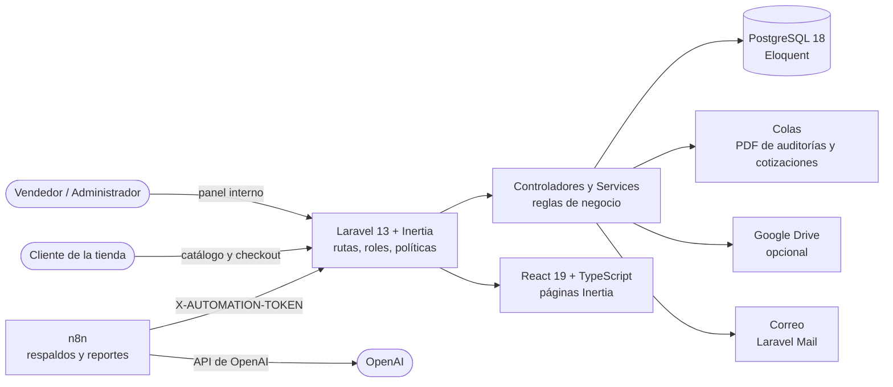
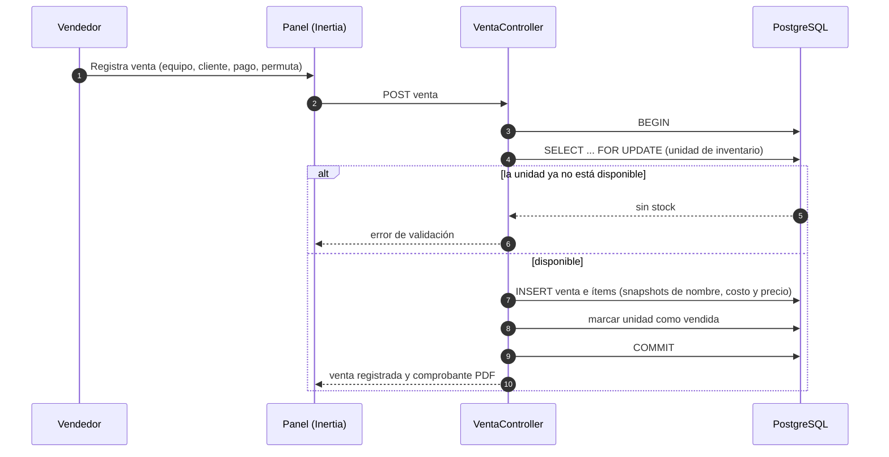
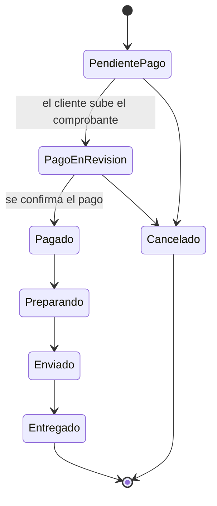
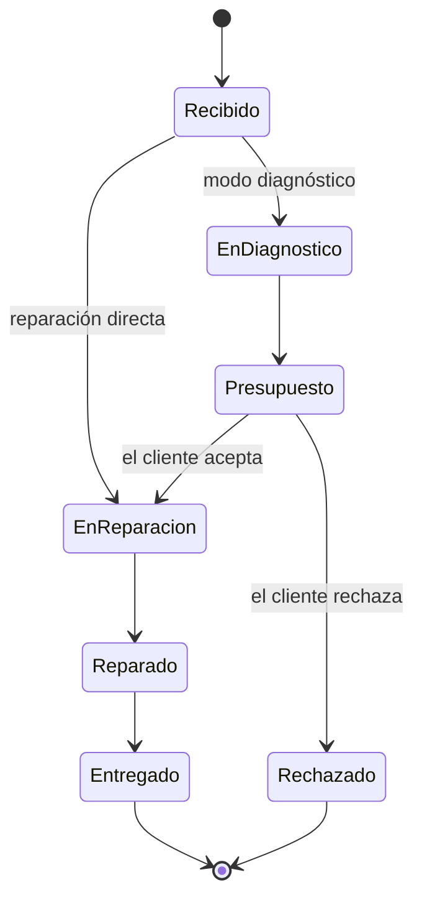
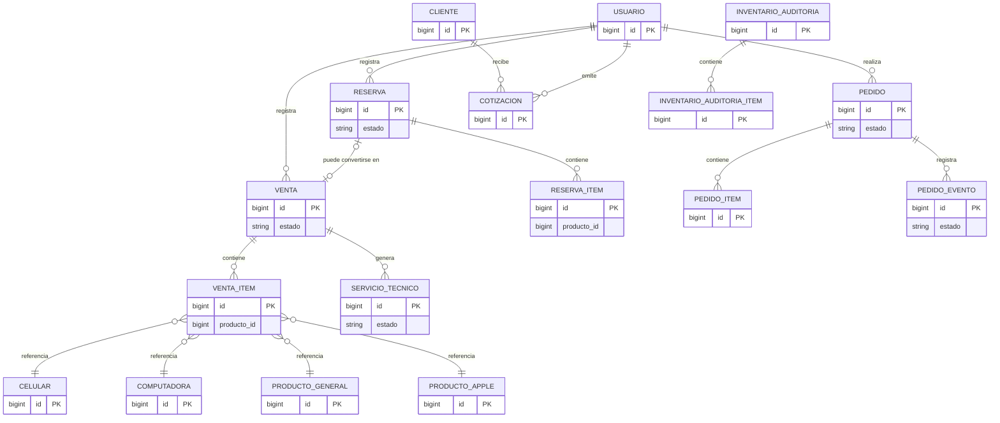

<div align="center">

<br/>

**Sistema de gestión comercial e inventario, con tienda pública, para un negocio de productos y servicios tecnológicos.**


<br/>


</div>


## 📑 Contenido

- [El problema](#-el-problema)
- [La solución](#-la-solución)
- [Funcionalidades](#-funcionalidades)
- [Arquitectura](#%EF%B8%8F-arquitectura)
- [Flujos de trabajo](#-flujos-de-trabajo)
- [Modelo de datos](#%EF%B8%8F-modelo-de-datos)
- [Criterios y decisiones](#-criterios-y-decisiones)
- [Stack](#%EF%B8%8F-stack)
- [Estructura del repo](#%EF%B8%8F-estructura-del-repo)
- [Puesta en marcha](#-puesta-en-marcha)
- [Pruebas y calidad](#-pruebas-y-calidad)
- [Despliegue](#-despliegue)
- [Estado y pendientes](#-estado-y-pendientes)
- [Licencia y autoría](#-licencia-y-autoría)


## 🧩 El problema

Un negocio de equipos Apple y tecnología vende unidades **únicas**: cada celular, computadora o accesorio tiene su código, su IMEI o su número de serie. Antes del sistema, el stock, las reservas, las permutas y las reparaciones vivían en planillas y en la memoria del equipo de ventas. Eso producía dobles ventas sobre el mismo equipo, costos y procedencias visibles para quien no debía verlos, y reportes que no coincidían con la caja.

## 💡 La solución

**Apple Boss** centraliza ventas, reservas, clientes, cotizaciones, inventario, egresos y servicio técnico en un solo panel, y publica una **tienda en línea** con el mismo inventario, sin exponer datos internos.

| Rol | Qué hace en el sistema |
|---|---|
| **Administrador** | Ve todo: costos, ganancias, procedencia, usuarios, reportes, auditorías y configuración de la tienda. |
| **Vendedor** | Registra ventas, reservas, clientes, cotizaciones y servicios. Nunca ve costo, ganancia ni procedencia: se quitan en el servidor. |
| **Cliente de la tienda** | Navega el catálogo, compara modelos, arma su carrito, paga y sigue su pedido. |


## ✨ Funcionalidades

<details open>
<summary><b>Panel interno (administrador y vendedor)</b></summary>

- **Ventas**: registro y edición con actualización de stock, permutas, métodos de pago y comprobantes PDF (formato estándar y 80 mm).
- **Reservas** con ítems, estados y comprobantes; al concretarse se convierten en venta.
- **Inventario por tipo**: celulares, computadoras, productos Apple y productos generales, identificados por código, IMEI o número de serie.
- **Clientes, cotizaciones** con PDF, envío por correo en cola y publicación opcional en Google Drive.
- **Servicio técnico**: recepción, diagnóstico o reparación directa, presupuesto y entrega.
- **Egresos, reportes comerciales, dashboards** y exportaciones PDF.
- **Auditorías de inventario** por escaneo, con conciliación de faltantes, novedades y salidas justificadas, y PDF final generado en cola.
- **Notificaciones internas** y roles (`admin`, `vendedor`) con permisos por módulo.

</details>

<details open>
<summary><b>Tienda pública</b></summary>

- Inicio configurable, catálogo filtrable, búsqueda y fichas de producto con galería.
- **Comparadores** de iPhone, Mac, cargadores y vidrios; el precio y el stock los calcula el servidor desde el inventario.
- Fichas técnicas por modelo (160: 38 iPhone y un Pixel, 18 Mac y una laptop gaming, 44 productos Apple —iPad, Apple Watch, AirPods, Apple TV y Magic Keyboard— y 58 tipos de accesorio), validadas por esquema y tomadas de las fichas oficiales de cada marca.
- Carrito que vuelve a consultar precio, publicación y disponibilidad en el servidor antes de cobrar.
- Checkout con pedidos y seguimiento; páginas de contenido, preguntas frecuentes, novedades y cotizador de **trade-in**.
- SEO técnico: slugs, metadatos, datos estructurados, `robots.txt` y sitemap XML.

</details>

<details>
<summary><b>Automatización</b></summary>

- **Respaldo** de PostgreSQL con n8n en entorno local, y en producción un script nocturno de respaldo más un respaldo semanal de archivos subidos.
- **Reporte comercial semanal con IA**: Laravel calcula las cifras; OpenAI solo redacta el análisis en JSON. Si la respuesta no es válida, se guarda un resumen factual de respaldo. Queda como notificación para revisión humana.
- **API de integración** con tokens de automatización que se comparan en tiempo constante, con límite de solicitudes y un token separado para la exportación financiera.

</details>


## 🏗️ Arquitectura

<p align="center">
  
</p>

Es un **monolito modular**: Laravel concentra rutas, seguridad, reglas de negocio, datos e integraciones; Inertia.js conecta los controladores con React sin una API REST para cada pantalla. Las APIs JSON quedan para la búsqueda y el carrito públicos, las consultas de stock y la comunicación con automatizaciones.




## 🔄 Flujos de trabajo

### Venta con control de stock

Dos vendedores no pueden vender la misma unidad: la selección del inventario se hace dentro de una transacción con bloqueo de fila.



### Estados de un pedido de la tienda



### Estados de un servicio técnico

El camino depende del modo de ingreso: la **reparación directa** salta el diagnóstico y el presupuesto.




## 🗃️ Modelo de datos

Las tablas se generan con migraciones Eloquent; los productos de inventario tienen una tabla por tipo y las ventas y reservas apuntan a la tabla correspondiente.



Los ítems de venta guardan **snapshots** de nombre, categoría, costo y precio, así que un reporte histórico no cambia cuando cambia el producto.


## 🧭 Criterios y decisiones

| Decisión | Por qué |
|---|---|
| **Monolito Laravel + Inertia + React** | Una sola aplicación desplegable que comparte rutas, validación y autorización con el frontend, sin duplicar una API para cada pantalla. |
| **Tienda separada del inventario operativo** | La publicación pública tiene su propio modelo y solo expone campos permitidos. Costo, IMEI y número de serie nunca llegan a una página pública. |
| **Transacciones y bloqueos pesimistas** | Una unidad de inventario se vende una sola vez; `lockForUpdate()` coordina ventas y reservas. |
| **La IA no calcula cifras** | Laravel calcula facturación, utilidad, margen y período; el workflow vuelve a imponerlos sobre la respuesta del modelo antes de guardarla. |
| **Ficha técnica con doble fuente** | Lo que publica el fabricante entra primero. Lo que no publica se carga solo si lo confirman dos fuentes externas; si no, queda pendiente. |
| **Tailwind 3 y no 4** | La versión 4 no funciona en iPhone con iOS anterior a 16.4. `vite.config.js` fija navegadores objetivo y se agregan polyfills para iOS 14 y 15. |
| **Vendedor sin costos** | Se quitan en el servidor (`SinCostos`) en listados, API de stock, registro de ventas y reservas, no solo en la pantalla. |
| **Horario de ingreso del vendedor** | Solo puede iniciar sesión en horario laboral (`America/La_Paz`), configurable en `config/horario.php`. El administrador no tiene esa restricción. |

**Seguridad**, en resumen:

- Las áreas internas exigen sesión y middleware de rol. El registro público está deshabilitado.
- Límites de solicitudes en ingreso, recuperación, verificación de correo y rutas de automatización. Los proxies de confianza se declaran explícitamente (`TRUSTED_PROXIES`, por defecto ninguno).
- Política de contraseñas estricta, con comprobación de contraseñas comprometidas en el alta de usuarios.
- El contenido enriquecido se limpia con lista permitida de etiquetas y enlaces; hay pruebas contra `script`, atributos de evento, iframes y URLs `javascript:`.
- Subidas limitadas a JPG, JPEG, PNG o WebP de hasta 10 MB; cabeceras CSP, HSTS en producción y anti-clickjacking.

Auditoría de extremo a extremo (caja negra, caja blanca y carga con k6): 6 hallazgos, todos corregidos y verificados. Ver [`docs/seguridad/`](docs/seguridad/README.md).


## 🛠️ Stack

| Capa | Tecnología | Versión |
|---|---|---|
| Backend | Laravel · PHP | 13 (13.32 en `composer.lock`) · 8.5 en producción y desarrollo; `composer.json` admite desde 8.3 |
| Autenticación y API | Sesión, Sanctum, Ziggy | Sanctum 4 · Ziggy 2 |
| Frontend | React · Inertia · TypeScript | 19.3 · 3.7 · JavaScript con React (TypeScript no aparece en `package.json`) |
| Estilos | Tailwind CSS | 3.x (se mantiene en la 3) |
| Build | Vite | 8.3 |
| Datos | PostgreSQL | 18 (Docker Compose) |
| PDF | Dompdf (`barryvdh/laravel-dompdf`) | 3.1 |
| Integraciones | Google API Client y Flysystem (Drive) · Laravel Mail · OpenAI vía n8n | n8n 2.39 |
| Pruebas | PHPUnit · SQLite en memoria | 12.5 |
| Infraestructura | Docker Compose · Caddy · Cloudflare | Apache con PHP 8.5 en la imagen |


## 🗂️ Estructura del repo

```text
.
├── Dockerfile · Dockerfile.production   imagen de desarrollo y de producción
├── docker-compose.yml                   entorno local: app, cola, PostgreSQL, Adminer, n8n
├── docker-compose.production.yml        producción: app, cola, programador, PostgreSQL, Caddy
├── docker/                              imágenes auxiliares y scripts de respaldo
├── n8n/workflows/                       respaldo y reporte semanal con IA
├── docs/                                despliegue, seguridad, integraciones, admin-ui y diagramas
└── src/                                 aplicación Laravel
    ├── app/Http/Controllers/            ventas, reservas, tienda, pedidos, API e integraciones
    ├── app/Models/                      entidades Eloquent
    ├── app/Services/ · app/Support/     códigos, fichas técnicas, SEO y reglas compartidas
    ├── database/migrations/             esquema y restricciones únicas
    ├── resources/js/                    páginas y componentes React (Inertia)
    ├── resources/views/                 shell Blade, correos y plantillas PDF
    ├── routes/                          web, autenticación, API y automatización
    └── tests/                           pruebas Feature y Unit
```


## 🚀 Puesta en marcha

**Con Docker Compose**

```bash
docker compose up --build
docker compose exec app php artisan migrate
```

Antes hay que crear los dos archivos de entorno a partir de sus plantillas: `.env.example` en la raíz (la base PostgreSQL de Compose) y `src/.env.example` (Laravel, que ya apunta al servicio `db`). La contraseña de la base tiene que ser la misma en los dos. Después, completar el token de automatización. OpenAI, Google Drive y Cloudflare son opcionales según los servicios que se usen. Ningún secreto se versiona.

**Sin Docker** (requiere PHP 8.3 o superior, Composer, Node.js y una base compatible con las migraciones)

```bash
cd src
composer install
npm install
cp .env.example .env
php artisan key:generate
php artisan migrate
composer run dev   # servidor Laravel, cola, visor de logs y Vite
```

Para compilar los assets de producción: `npm run build` dentro de `src/`.


## 🧪 Pruebas y calidad

```bash
cd src
composer test      # limpia la configuración y ejecuta php artisan test
npm run build
```

- **915 pruebas** y 7.843 aserciones en 120 clases, casi todas Feature (896 Feature y 19 Unit). Cubren autenticación y roles, ventas, servicios, reservas, stock, auditorías, configuración, catálogo y privacidad pública, checkout, correos, API de integración, XSS, SEO y el constructor del inicio.
- La suite usa SQLite en memoria, caché y sesiones en memoria, correo simulado y cola síncrona.
- `tests/TestCase.php` usa `withoutDeprecationHandling()`: un aviso de obsolescencia de PHP hace fallar la prueba, para detectar antes una incompatibilidad con la siguiente versión.
- La suite pasó completa el **16-11-2026**: 915 pruebas, 0 fallos (PHP 8.5.12, 2 min 38 s). Se corre antes de cada despliegue.
- Necesita el `memory_limit` de 1 GB que fija `src/docker/php.ini`: con los 128 MB por defecto de PHP, la exportación de PDF con dompdf se queda sin memoria a mitad de la suite.
- Sin avisos de obsolescencia de PHP 8.5. Los dos que daba `config/database.php` (`PDO::MYSQL_ATTR_SSL_CA`) se corrigieron con `Pdo\Mysql::ATTR_SSL_CA`, como en el esqueleto actual de Laravel. Ojo: un aviso que salta al cargar la configuración ocurre antes de que actúe `withoutDeprecationHandling()` y no hace fallar la suite; hay que mirarlo en el resumen de PHPUnit.
- No hay pipeline de CI (ni GitHub Actions, GitLab CI o Jenkins).


## 🐳 Despliegue

- Producción corre en un VPS con Docker, detrás de Cloudflare y Caddy (HTTPS). Tres procesos salen de la misma imagen: aplicación, worker de colas y programador.
- Cada despliegue hace respaldo de la base, comprueba que el respaldo se restaura, etiqueta la imagen anterior para volver atrás y verifica el sitio al terminar.
- Respaldo nocturno de la base y respaldo semanal de archivos subidos (cron del VPS, script en `docker/production/`).
- Procedimiento completo en [`docs/DESPLIEGUE.md`](docs/DESPLIEGUE.md).
- No hay manifiestos de Kubernetes ni Helm.


## 📌 Estado y pendientes

- **En producción** según [`docs/DESPLIEGUE.md`](docs/DESPLIEGUE.md) (despliegues documentados desde el 18-09-2026). No verificado desde este README.
- Último commit del repositorio: **13-11-2026**, campaña de temporada de la tienda (correos, PDF y páginas), con apagado desde el panel.
- Pendiente documentado: **no hay copia de la base fuera del servidor**; los respaldos viven solo en el VPS.
- Pendiente de CI/CD: la suite se corre a mano antes de cada despliegue.
- Documento histórico: `CURRENT_ARCHITECTURE.md` describe el sistema de septiembre de 2026 y está marcado como tal; lo vigente está en este README y en `docs/`.


## 📄 Licencia y autoría

Desarrollado por el **Ing. Santiago Abasto**.


Código propietario del cliente. El repositorio no incluye archivo de licencia; no se publica ni se distribuye sin autorización.
